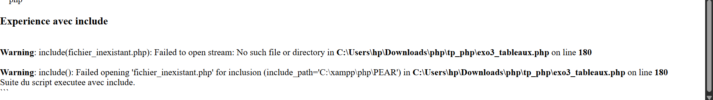
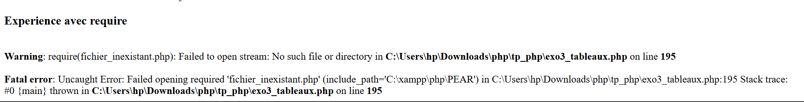

<<<<<<< HEAD
## Partie 4 : Fichiers externes et formulaires
### Exercice 4.1 : Factorisation de l'interface
3. Expérience 1 : remplacez le nom d'un fichier par un nom inexistant, d'abord avec `include`, puis avec `require`. Notez en commentaire ce qui change (type de message, exécution ou non de la suite du script).   

=======
## Réalisation du TP
Ce travail pratique a été réalisé en collaboration avec ma camarade *[Arwa M'barki]*.
Nous avons travaillé ensemble sur les différents exercices afin de comprendre et d'appliquer 
les notions étudiées en programmation PHP.
>>>>>>> 0093da2f90b0ba14d8e64627342a1907e85a788a
